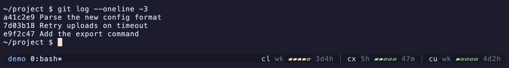
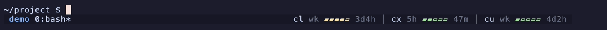
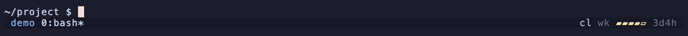
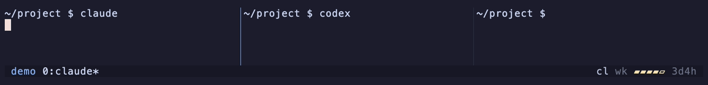
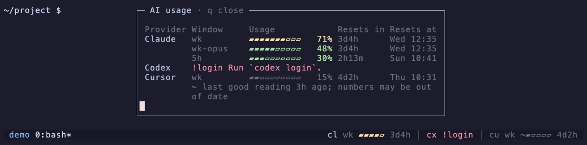
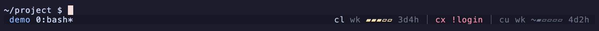

# tmux-ai-usage

See how much of your Claude, Codex and Cursor plan quota you've used, and when it resets, right in the tmux status line.



- One **usage bar** per provider: which quota window, how full it is, and the time until it resets.
- Green, then yellow from 60%, then red from 85%.
- Never makes tmux wait: readings are cached and refreshed in the background.
- macOS only in v1; tmux ≥ 3.2 for the bars to shrink on narrow terminals.

Terms such as *plan quota*, *quota window* and *usage snapshot* are defined in [`GLOSSARY.md`](GLOSSARY.md).

## Quick start

1. Add these lines to `~/.tmux.conf`. If you already use [TPM](https://github.com/tmux-plugins/tpm) and a theme, add only the lines you're missing, and keep this plugin **after** your theme:

   ```tmux
   set -g @plugin 'tmux-plugins/tpm'
   set -g @plugin 'catppuccin/tmux'          # your theme, if you use one
   set -g @plugin 'isenthamiz/tmux-ai-usage' # after the theme

   set -g @ai_usage_providers 'claude codex cursor'   # keep only the ones you use
   set -g status-right '#{ai_usage} │ %H:%M'

   run '~/.tmux/plugins/tpm/tpm'
   ```

2. In tmux, press `prefix + I` to install the plugin.
3. Install `jq`: `brew install jq`. Cursor needs a little more; see [Requirements](#requirements).
4. Sign in to each provider you kept: run `claude` once, run `codex login`, and open the Cursor app.
5. Press `prefix + r` to reload tmux (or restart it).

You should now see the usage bars in your status line, as in the picture above. For a moment each provider shows its label dimmed with `…` (for example `cl …`), until its first reading arrives. Nothing showing, or a literal `#{ai_usage}`? See [Troubleshooting](#troubleshooting).

## Reading a usage bar

```
cl  wk  ▰▰▰▱▱  3d4h
│   │   │      └─ time until reset
│   │   └─ progress bar: how much is used
│   └─ quota window (wk = weekly)
└─ provider (cl = Claude)
```

This reads "Claude, weekly window, about 60% used, resets in 3 days 4 hours".

- **Colours:** the progress bar is green, turns yellow from 60% and red from 85%. Both thresholds are adjustable in the [Reference](#colours-and-thresholds).
- **Which window:** a provider can have several quota windows at once, for example Claude's 5-hour and weekly windows. The bar shows whichever is most used right now. To always show one, pin it: `set -g @ai_usage_claude_window wk`.
- **A number instead:** the full step shows no percentage. `set -g @ai_usage_bar_width 0` shows the percentage in place of the progress bar.
- **Every window at once:** press `prefix + u` for the [details popup](#everything-at-once-the-details-popup).

## Placement

You put a token in your status line, and when tmux loads, the plugin swaps it for the usage bars.

| Token | Shows |
|---|---|
| `#{ai_usage}` | All your providers in one place: side by side, or one at a time with [rotation](#one-provider-at-a-time) or [focus](#only-the-agent-in-this-pane) |
| `#{ai_usage_claude}`, `#{ai_usage_codex}`, `#{ai_usage_cursor}` | One provider each, so you can put them in different places |

A plain status line:

```tmux
set -g status-right '#{ai_usage} │ %H:%M'
```

With [catppuccin](https://github.com/catppuccin/tmux), next to one of its modules:

```tmux
set -g status-right '#{ai_usage} #{E:@catppuccin_status_session}'
```

Each provider in its own place:

```tmux
set -g status-left '#{ai_usage_claude} '
set -g status-right '#{ai_usage_cursor} │ %H:%M'
```

Good to know:

- The plugin line must come **after** your theme's line in `~/.tmux.conf`. If you see a literal `#{ai_usage}` in the status line, the order is wrong.
- Adding or moving a token needs `prefix + r`.

## Tour

### Narrow terminals shrink the usage bars



*Breakpoints scaled down for the picture; the defaults are 180 / 140 / 110 / 80 columns.*

As the terminal gets narrower, every usage bar drops parts in **steps**, all providers together:

- full: `cl wk ▰▰▰▰▱ 3d4h │ cx 5h ▰▰▱▱▱ 47m`
- step 1: `cl ▰▰▰▰▱ 3d4h │ cx ▰▰▱▱▱ 47m` (window labels go)
- step 2: `cl ▰▰▰▰▱ cx ▰▰▱▱▱` (countdowns go, except at or above the red threshold)
- step 3: `cl 71% cx 42%` (percentages instead of progress bars)
- step 4: `cl cx`, each label in its usage colour

Always the full step, whatever the width:

```tmux
set -g @ai_usage_step full
```

Always compact:

```tmux
set -g @ai_usage_step 2
```

Shrinking automatically needs tmux 3.2 or newer; older tmux shows the full step unless you set one. The breakpoints are adjustable: see [Steps](#steps) in the Reference.

### One provider at a time



With **rotation**, `#{ai_usage}` shows one provider at a time, each for an equal turn (10 seconds by default, rounded up to whole `status-interval` ticks). It's for a crowded status line where you still want to keep an eye on every provider.

```tmux
set -g @ai_usage_rotate on
set -g @ai_usage_rotate_interval 20   # optional: seconds per provider
```

It applies on the next redraw, with no reload. Only `#{ai_usage}` rotates, and with one provider nothing does. Details in [Rotation](#rotation).

### Only the agent in this pane



With **focus**, `#{ai_usage}` shows only the provider whose AI agent runs in the pane you're in: Claude Code, Codex, or Cursor's CLI. In a plain shell pane you get the usual view. It's for running agents in separate panes when you only care about the one in front of you.

```tmux
set -g @ai_usage_focus on
```

Then press `prefix + r`: focus is read when the plugin loads. It wins over rotation, and an agent paused with `^Z` isn't detected.

Focus and rotation together, as in the picture: in an agent's pane you see that provider; anywhere else the providers take turns.

```tmux
set -g @ai_usage_focus on
set -g @ai_usage_rotate on
```

Details in [Focus](#focus).

### Everything at once: the details popup



Press `prefix + u` for every quota window of every provider: its progress bar, percentage, time until reset and the reset as local clock time. Problems are spelled out with their fix. Use it to check the weekly window while the bar shows the 5-hour one, or to find out what a `!` means. `q` or `Esc` closes it.

To open it with a different key (then press `prefix + r`):

```tmux
set -g @ai_usage_details_key 'U'
```

Details in [Details popup](#details-popup).

### When something's wrong



A usage bar shows a **marker** when a reading isn't plainly good:

| You see | Meaning | Fix |
|---|---|---|
| `cl …` (dim) | No reading yet | Wait for the first reading |
| `cu wk ~▰▱▱▱▱ 4d2h` (dim) | The last good reading is old (stale) | Check your network; run [`doctor.sh`](#diagnostics) |
| `cx !login` | The provider no longer accepts your sign-in | Claude: run `claude` and `/login`. Codex: `codex login`. Cursor: sign in to the app |
| `cx !deps` | Something the plugin needs is missing | See [Requirements](#requirements); for Cursor, allow the Keychain prompt |
| `cu !format` | The provider answered in a shape the plugin doesn't know | Update the plugin, or open an issue |
| `cl !error` | A temporary failure, with no earlier good reading | Clears by itself |
| `!jq` | `jq` isn't installed | `brew install jq`, then `prefix + r` |

- At step 4 the `!` markers become `cl!` in red, so "action needed" stays distinct from a red label meaning high usage.
- A window whose reset time has passed shows 0% until the next reading.
- The [details popup](#everything-at-once-the-details-popup) shows the fix for each problem too.

## Requirements

**Platform:** macOS only in v1. tmux ≥ 3.2 for width-aware [steps](#steps); older tmux always shows the full step.

| Component | Claude | Codex | Cursor |
|---|---|---|---|
| [`jq`](https://jqlang.org/) | required | required | required |
| `claude` CLI | required, signed in | — | — |
| `curl` | — | required | required |
| Codex CLI sign-in | — | required (`~/.codex/auth.json`) | — |
| `sqlite3` | — | — | required |
| `security` (Keychain) | — | — | required |
| Homebrew [`openssl@3`](https://formulae.brew.sh/formula/openssl@3) | — | — | required (must support `openssl kdf`; macOS `/usr/bin/openssl` is not enough) |
| Cursor app | — | — | required, signed in |

The plugin checks for `jq` when tmux loads. If `jq` is missing, every usage token is replaced with `!jq` in the crit colour.

### Cursor Keychain

The first time the plugin reads Cursor's sign-in, macOS may ask for Keychain access to **Cursor Safe Storage**. Choose **Always Allow**, so later readings don't wait on the dialog. If you refuse, Cursor's bar shows `!deps` until you allow it.

## Troubleshooting

**I see a literal `#{ai_usage}`, or nothing at all.** The plugin line must come *after* your theme plugin in `~/.tmux.conf`, so the token is already in the status line when this plugin replaces it. Fix the order, then press `prefix + r`. If you have just added the plugin, press `prefix + I` first so TPM installs it.

**A provider shows its label dimmed, followed by `…` (for example `cl …`).** No reading has arrived yet. The first one starts when the status line first draws and appears as soon as the provider answers.

**`!jq`.** Install it with `brew install jq`, then press `prefix + r`.

**`!login`.** That provider no longer accepts your sign-in:

- Claude: run `claude` and sign in with `/login`.
- Codex: run `codex login`.
- Cursor: open the Cursor app and sign in.

**`!deps`.** Something the plugin needs is missing; see [Requirements](#requirements). For Cursor, check that you allowed the [Keychain prompt](#cursor-keychain) and installed Homebrew `openssl@3`.

**I changed an option and nothing happened.** Some options are only read when the plugin loads; see [How options work](#how-options-work).

The [details popup](#details-popup) spells out every problem with its fix.

### Diagnostics

`scripts/doctor.sh` reads **cached usage snapshots only** (no live fetch). Run it from a shell inside a tmux session, where it uses your global tmux options, or bind it to a key:

```tmux
bind-key D run-shell 'bash ~/.tmux/plugins/tmux-ai-usage/scripts/doctor.sh'
```

Change the path if TPM cloned the plugin elsewhere. The output covers dependency checks; one line per provider with its snapshot status, the age of the last good reading, `retry_at` and a short error; and the options in effect.

For a one-off live fetch (manual debugging, not used in CI), run `scripts/smoke.sh`. It prints usage numbers only, never tokens.

## Reference

[How options work](#how-options-work) · [What to show](#what-to-show) · [Steps](#steps) · [Rotation](#rotation) · [Focus](#focus) · [Details popup](#details-popup) · [Progress bar](#progress-bar) · [Colours and thresholds](#colours-and-thresholds) · [Refresh and cache](#refresh-and-cache)

### How options work

- Every option is an ordinary tmux user option: `set -g @ai_usage_<name> '<value>'`. It can go anywhere in `~/.tmux.conf`, before or after the plugin line.
- Most options apply on the next status-line redraw, with no reload. To try one live, run it in a shell: `tmux set -g @ai_usage_bar_width 0`.
- Three things are read only when the plugin loads, so they need `prefix + r` (or a tmux restart): `@ai_usage_focus`, `@ai_usage_details_key`, and adding or moving a `#{ai_usage…}` token in `status-left` or `status-right`.
- An invalid value is reported when the plugin loads, with one message per bad option, and the default is used instead. (`@ai_usage_providers` only drops the names it doesn't know.) A value that becomes invalid later silently falls back to the default.

### What to show

#### `@ai_usage_providers`

Which providers `#{ai_usage}` shows, and in what order. Leave out the providers you don't use, so they don't show `!login` or `!deps`.

- **Values:** a space-separated list of `claude`, `codex`, `cursor`. Unknown names are reported at load and dropped.
- **Default:** `claude codex cursor`
- **Applies:** on the next redraw
- **Ignored by:** the per-provider tokens. `#{ai_usage_cursor}` still works when Cursor is left out here.

```tmux
set -g @ai_usage_providers 'claude cursor'
```

#### `@ai_usage_claude_window`, `@ai_usage_codex_window`, `@ai_usage_cursor_window`

Which quota window that provider's usage bar shows. `auto` shows whichever window has the highest usage right now. A window label pins one window. If the provider isn't reporting that window, the bar falls back to `auto`.

| Provider | Window labels | Default |
|---|---|---|
| Claude | `5h`, `wk`, and model-scoped weekly windows such as `wk-opus`, `wk-sonnet` (`wk-<model>`) | `auto` |
| Codex | `5h`, `wk` | `auto` |
| Cursor | `wk` on unified plans; `mo-auto`, `mo-api` on legacy plans | `auto` |

- **Applies:** on the next redraw
- **Ignored by:** the [details popup](#details-popup), which always lists every window.

```tmux
set -g @ai_usage_claude_window 'wk'
```

In the Tour: [Reading a usage bar](#reading-a-usage-bar).

#### `@ai_usage_claude_label`, `@ai_usage_codex_label`, `@ai_usage_cursor_label`

The provider label at the start of each usage bar.

| Option | Default |
|---|---|
| `@ai_usage_claude_label` | `cl` |
| `@ai_usage_codex_label` | `cx` |
| `@ai_usage_cursor_label` | `cu` |

- **Values:** any text
- **Applies:** on the next redraw

```tmux
set -g @ai_usage_claude_label 'claude'
```

#### `@ai_usage_separator`

The text between providers when `#{ai_usage}` shows them side by side, at the full step and step 1. Steps 2–4 always use a single space.

- **Values:** any text
- **Default:** ` │ ` (a vertical bar with a space either side)
- **Applies:** on the next redraw
- **Ignored when:** only one provider is shown (rotation, focus, or a per-provider token)

```tmux
set -g @ai_usage_separator '  '
```

### Steps

#### `@ai_usage_step`

How much of each usage bar to show. With `auto` the bar shrinks as the terminal narrows, through the steps listed below. Any other value holds that step at every width; `full` is the "always the detailed bar" setting.

| Step | Looks like |
|---|---|
| full | `cl 5h ▰▱▱▱▱ 3h58m │ cx wk ▰▰▰▱▱ 1d14h` |
| 1 | `cl ▰▱▱▱▱ 3h58m │ cx ▰▰▰▱▱ 1d14h` |
| 2 | `cl ▰▱▱▱▱ cx ▰▰▰▱▱` (countdown only at or above crit) |
| 3 | `cl 16% cx 66%` (countdown only at or above crit) |
| 4 | `cl cx`, each label in its usage colour |

- **Values:** `auto`, `full`, `1`, `2`, `3`, `4`
- **Default:** `auto`
- **Applies:** on the next redraw
- Before tmux 3.2, `auto` always shows the full step; a forced step still applies.

```tmux
set -g @ai_usage_step full
```

In the Tour: [Narrow terminals shrink the usage bars](#narrow-terminals-shrink-the-usage-bars).

#### `@ai_usage_step_widths`

The narrowest terminal, in columns, at which the full step, step 1, step 2 and step 3 still show. Anything narrower than the last number gets step 4. Each tmux client gets its own step, so a narrow and a wide terminal attached to the same session each show what fits.

- **Values:** four whole numbers, largest first
- **Default:** `180 140 110 80`
- **Applies:** on the next redraw
- **Ignored when:** `@ai_usage_step` is not `auto`, or tmux is older than 3.2

```tmux
set -g @ai_usage_step_widths '200 160 120 90'
```

In the Tour: [Narrow terminals shrink the usage bars](#narrow-terminals-shrink-the-usage-bars).

### Rotation

#### `@ai_usage_rotate`

With `on`, `#{ai_usage}` shows one provider at a time instead of all side by side. It cycles through `@ai_usage_providers` in order and gives every provider an equal turn, whatever its usage or state. Every tmux client shows the same provider at the same moment.

- **Values:** `off`, `on`
- **Default:** `off`
- **Applies:** on the next redraw
- **Ignored by:** the per-provider tokens. Nothing rotates with only one provider, and [focus](#focus) wins in a pane running an agent.

```tmux
set -g @ai_usage_rotate on
```

In the Tour: [One provider at a time](#one-provider-at-a-time).

#### `@ai_usage_rotate_interval`

How many seconds each provider stays on screen. The value is rounded up to whole `status-interval` ticks, because tmux only redraws the status line that often. With tmux's default `status-interval` of 15, a value of `10` gives 15-second turns; lower `status-interval` for shorter ones.

- **Values:** a whole number, 1 or more
- **Default:** `10`
- **Applies:** on the next redraw
- **Ignored when:** `@ai_usage_rotate` is `off`

```tmux
set -g @ai_usage_rotate_interval 20
```

In the Tour: [One provider at a time](#one-provider-at-a-time).

### Focus

#### `@ai_usage_focus`

With `on`, `#{ai_usage}` shows only the provider whose AI agent runs in the active pane: Claude Code, Codex, or Cursor's CLI. In a pane with no agent, or one whose provider isn't in `@ai_usage_providers`, the usual view returns (side by side, or rotation). Only the pane's foreground process counts, so an agent suspended with `^Z` isn't detected.

- **Values:** `off`, `on`
- **Default:** `off`
- **Applies:** after `prefix + r`
- **Ignored by:** the per-provider tokens

```tmux
set -g @ai_usage_focus on
```

In the Tour: [Only the agent in this pane](#only-the-agent-in-this-pane).

### Details popup

#### `@ai_usage_details_key`

The key, pressed after the tmux prefix, that opens the details popup: every quota window of every enabled provider, with the time until reset and the reset as local clock time. `q` or `Esc` closes it. If the key already does something in your tmux setup, the popup replaces it.

- **Values:** a tmux key name, or empty (`''`) to bind nothing
- **Default:** `u` (`prefix + u`)
- **Applies:** after `prefix + r`

```tmux
set -g @ai_usage_details_key 'U'
```

In the Tour: [Everything at once: the details popup](#everything-at-once-the-details-popup).

### Progress bar

#### `@ai_usage_bar_width`

How many cells the progress bar has. `0` shows the percentage in place of the progress bar. (Step 3 shows the percentage anyway, and step 4 shows labels only.)

- **Values:** a whole number, 0 or more
- **Default:** `5`
- **Applies:** on the next redraw

```tmux
set -g @ai_usage_bar_width 0
```

#### `@ai_usage_bar_filled`, `@ai_usage_bar_empty`

The characters drawn for used and unused cells of the progress bar. Change them if your font lacks `▰` and `▱`. Use a single character each, so the bar keeps its width.

| Option | Default |
|---|---|
| `@ai_usage_bar_filled` | `▰` |
| `@ai_usage_bar_empty` | `▱` |

- **Values:** any text
- **Applies:** on the next redraw

```tmux
set -g @ai_usage_bar_filled '#'
set -g @ai_usage_bar_empty '-'
```

### Colours and thresholds

#### `@ai_usage_warn_at`, `@ai_usage_crit_at`

The usage percentage at which the progress bar and percentage turn the warn colour, then the crit colour. At steps 2 and 3, the countdown is shown only at or above crit.

| Option | Default |
|---|---|
| `@ai_usage_warn_at` | `60` |
| `@ai_usage_crit_at` | `85` |

- **Values:** whole numbers from 0 to 100, with warn below crit. If warn isn't below crit, both go back to their defaults.
- **Applies:** on the next redraw

```tmux
set -g @ai_usage_warn_at 70
```

#### Colours

The colours of each part of a usage bar. If a catppuccin theme is loaded, the defaults follow its palette (`@thm_green`, `@thm_yellow`, `@thm_red`, `@thm_subtext_0`, `@thm_overlay_0`); otherwise they are the hex values below.

| Option | Colours | Default |
|---|---|---|
| `@ai_usage_ok_color` | progress bar and percentage below warn | `#a6e3a1` |
| `@ai_usage_warn_color` | progress bar and percentage at or above warn | `#f9e2af` |
| `@ai_usage_crit_color` | progress bar and percentage at or above crit, and the `!` markers | `#f38ba8` |
| `@ai_usage_text_color` | provider label | `#bac2de` |
| `@ai_usage_dim_color` | window label, countdown, separator, and stale or pending readings | `#6c7086` |

- **Values:** any tmux colour: `#rrggbb`, `colour0`–`colour255`, or a name such as `red`
- **Applies:** on the next redraw

```tmux
set -g @ai_usage_ok_color '#50fa7b'
set -g @ai_usage_warn_color '#f1fa8c'
set -g @ai_usage_crit_color '#ff5555'
set -g @ai_usage_text_color '#f8f8f2'
set -g @ai_usage_dim_color '#6272a4'
```

### Refresh and cache

#### `@ai_usage_refresh_interval`

How many seconds pass between readings of each provider's usage. Readings run in the background; the status line never waits for one.

- **Values:** a whole number; anything below 60 is raised to 60
- **Default:** `60`
- **Applies:** on the next redraw

```tmux
set -g @ai_usage_refresh_interval 120
```

#### `@ai_usage_stale_after`

How many seconds after the last good reading a usage bar is shown as stale: dimmed, with `~` before the progress bar.

- **Values:** a whole number, no smaller than `@ai_usage_refresh_interval`
- **Default:** `900` (15 minutes)
- **Applies:** on the next redraw

```tmux
set -g @ai_usage_stale_after 1800
```

#### `@ai_usage_cache_dir`

Where usage snapshots are kept, one file per provider. The directory is created if it doesn't exist and kept at mode `700`. It holds usage only, never credentials.

- **Values:** a full directory path (`~` and `$HOME` are not expanded)
- **Default:** `${XDG_CACHE_HOME:-$HOME/.cache}/tmux-ai-usage`
- **Applies:** on the next redraw; the new directory fills at the next reading

```tmux
set -g @ai_usage_cache_dir '/Users/me/.cache/ai-usage'
```

## Privacy: what it reads

The plugin only reads. It **never refreshes sign-in tokens**, never writes credentials anywhere, and its cache holds usage snapshots only (`<cache dir>/<provider>.json`). Spend, budgets and session context are out of scope; those fields are ignored.

### Claude

- **Live:** Claude Code CLI (`claude …`), using its experimental `get_usage` control request. The CLI handles sign-in; the plugin doesn't read Keychain credentials.
- **Fallback:** `~/.claude.json`, **only** its `.cachedUsageUtilization` object (not the rest of the file).

### Codex

- **File:** `~/.codex/auth.json`: `tokens.access_token` and `tokens.account_id`, read only (no token refresh).
- **Endpoint:** `GET https://chatgpt.com/backend-api/wham/usage`, sending those as headers.

### Cursor

- **File:** `~/Library/Application Support/Cursor/User/globalStorage/state.vscdb` (`sqlite3 -readonly`, key `cursorAuth/accessToken`).
- **Keychain:** `security find-generic-password` for the service **Cursor Safe Storage** (account **Cursor Key**, or the older **Cursor**).
- **Endpoints** (a session cookie derived from the token; no token refresh):
  - `POST https://cursor.com/api/dashboard/get-sand-usage-status` (body `{}`)
  - `GET https://cursor.com/api/usage-summary`, only when the first response says the unified plan is not active

## Development

```bash
make test     # shellcheck + bats
make images   # regenerate the screenshots in docs/images/; needs brew install vhs
```

See [`SPEC.md`](SPEC.md) for the architecture and [`GLOSSARY.md`](GLOSSARY.md) for the vocabulary.
